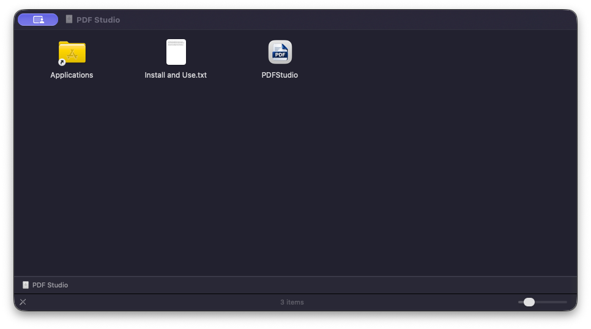
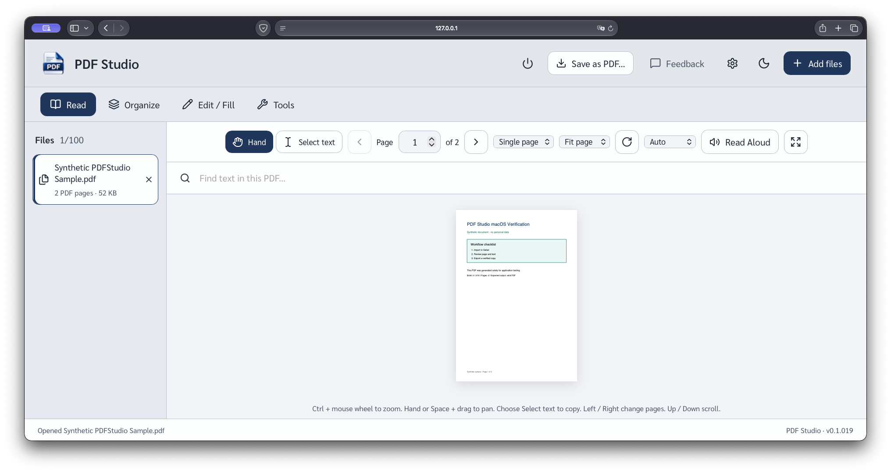
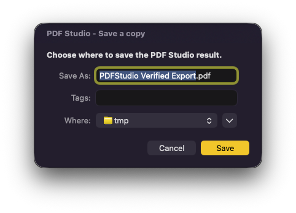

# PDF Studio สำหรับ macOS แบบ Apple Silicon

เอกสารนี้อธิบายวิธีใช้เวอร์ชัน 0.1.019 สองแบบในเครื่อง แบบ `.app` เหมาะกับการใช้งานทั่วไป ส่วนแบบ source/Safari เหมาะกับการพัฒนาและตรวจสอบ

## แบบแอปสำเร็จรูป: ไม่ต้องใช้ Terminal หรือ Homebrew

1. เปิด `dist/macos/PDFStudio-0.1.019-arm64.dmg`
2. ลาก **PDFStudio.app** ไปวางที่ลิงก์ **Applications**
3. Eject ดิสก์อิมเมจ แล้วเปิด PDFStudio จาก Applications หรือ Finder
4. แอปจะเปิด engine ภายในเครื่องที่ `127.0.0.1` เท่านั้น และเปิดหน้าจอใน Safari หากเปิดซ้ำ แอปจะใช้ engine เดิม ไม่สร้าง backend ซ้ำ
5. กด **Add files** หรือลากไฟล์เข้าหน้าต่าง แล้วเลือกงาน **Read**, **Organize**, **Edit / Fill** หรือ **Tools**
6. กด **Save as PDF…**, **Save a copy** หรือคำสั่ง export แล้วเลือกปลายทางจากหน้าต่าง Save ของ macOS หากมีไฟล์ชื่อเดิม แอปจะเติมเลขต่อท้ายและไม่เขียนทับ
7. ปิดด้วยปุ่ม power ในหน้าเว็บ หรือ **Quit PDF Studio** จากเมนูแอป/Dock การปิดเฉพาะแท็บ Safari จะยังไม่หยุด engine







แอปเก็บค่าตั้งไว้ที่ `~/Library/Application Support/PDFStudio` เอกสารที่กำลังทำงานและผลลัพธ์ชั่วคราวจะถูกล้างเมื่อปิด ควรบันทึกไฟล์ที่ต้องการเก็บก่อน Quit

## แบบ source/Safari

ข้อกำหนดของแบบนี้เท่านั้น: Mac Apple Silicon, Python 3.12 พร้อม Tk, Node/npm และ dependencies ของ repo การทดสอบครั้งนี้ใช้ Homebrew Python 3.12.15 และ PyInstaller 6.21.0 ไม่ต้องมี LibreOffice เว้นแต่จะเพิ่มงานแปลงไฟล์ Office ภายหลังโดยตั้งใจ

รันจากโฟลเดอร์หลักของ repo:

```sh
python3.12 -m venv .venv
.venv/bin/python -m pip install -r requirements.txt
npm --prefix web ci --ignore-scripts
.venv/bin/python scripts/prepare_assets.py --offline
npm --prefix web run build
```

จากนั้นดับเบิลคลิก `Start PDF Studio on macOS.command` หรือรัน:

```sh
.venv/bin/python run.py
```

แบบ source จะเปิด Safari และให้ Python ทำงานอยู่ใน Terminal ปิดจากหน้า PDFStudio หรือกด `Ctrl-C` ใน Terminal แบบนี้ต้องใช้ `.venv` และ `web/dist` แต่แบบ `.app` ไม่ต้องใช้

## ขอบเขตที่รองรับและข้อจำกัด

- สร้างและทดสอบสำหรับ arm64, macOS 13 ขึ้นไป โดยตรวจจริงบน Mac ชิป Apple M2 Pro ที่ใช้ macOS 27.0.1
- งาน PDF, รูปภาพ, text, Markdown, HTML, OCR, จัดหน้า, แก้ไข/redact และ export ทำในเครื่อง ควรเก็บต้นฉบับและตรวจไฟล์สำคัญหลัง export เพราะ PDF ที่ซับซ้อน เช่น form, signature, layer หรือฟอนต์พิเศษ อาจเปลี่ยนได้
- ไม่ได้รวม LibreOffice จึงยังใช้ Office-to-PDF ใน build นี้ไม่ได้
- แอปเซ็นแบบ ad-hoc และไม่ได้ notarize โดย Apple ห้ามปิด Gatekeeper หรือลบ quarantine หาก macOS ไม่ยอมเปิด ให้หยุดและขอ build ที่เชื่อถือได้/notarized
- เจ้าของ upstream อนุญาตให้เผยแพร่ source และแพ็กเกจของงานดัดแปลง macOS นี้ภายใต้ GNU AGPLv3 ใน [Issue #1](https://github.com/BerlinoPotato/PDFStudio/issues/1#issuecomment-6397084771) โดยให้ corresponding source รักษาข้อความลิขสิทธิ์ ให้เครดิต และลิงก์กลับต้นฉบับ คำอนุญาตแบบจำกัดขอบเขตนี้ไม่เปลี่ยน license ของ repo ต้นฉบับ
- PyMuPDF 1.28.0 ใช้ทางเลือก GNU AGPLv3 โดย release แนบ source archive ของ PyMuPDF รุ่นที่ตรงกันไว้ข้าง binary และมี source/build scripts ของงานดัดแปลงใน tag ที่ตรงกับ release

ดู [คำอนุญาตจาก upstream](UPSTREAM_PERMISSION.md), [บันทึกรีลีส](RELEASE_NOTES-0.1.019.md) และ `packaging/THIRD_PARTY_NOTICES.md` สำหรับผลทดสอบและรายการ dependencies
